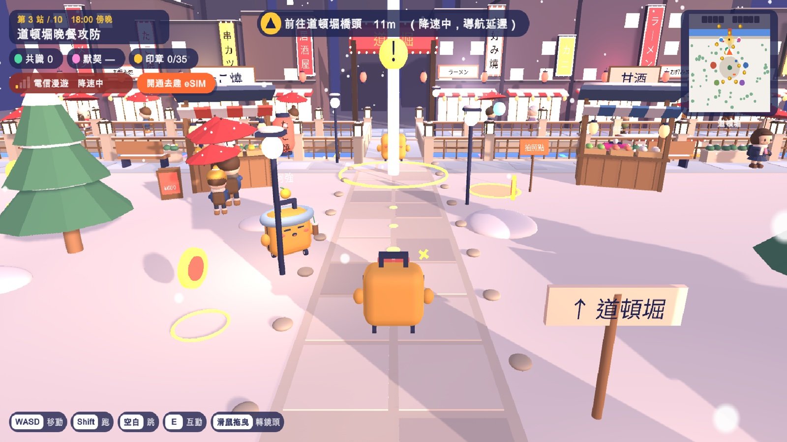
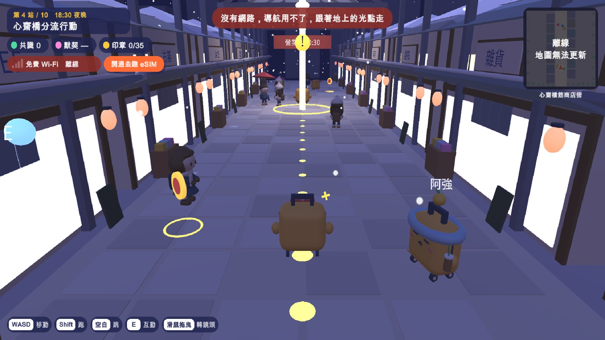
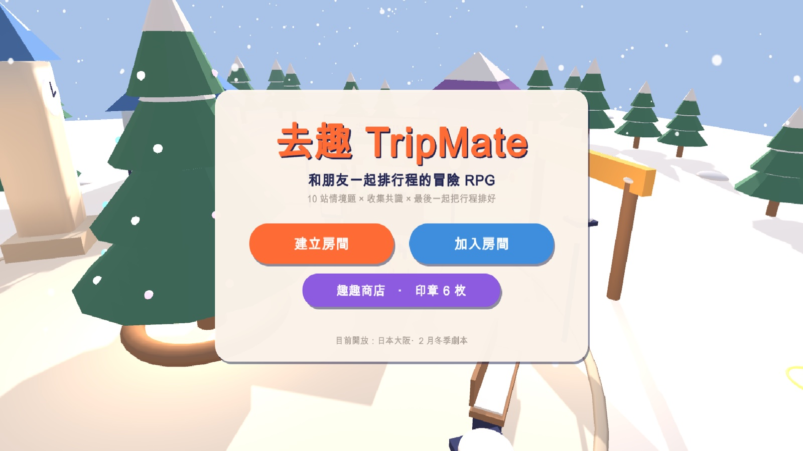
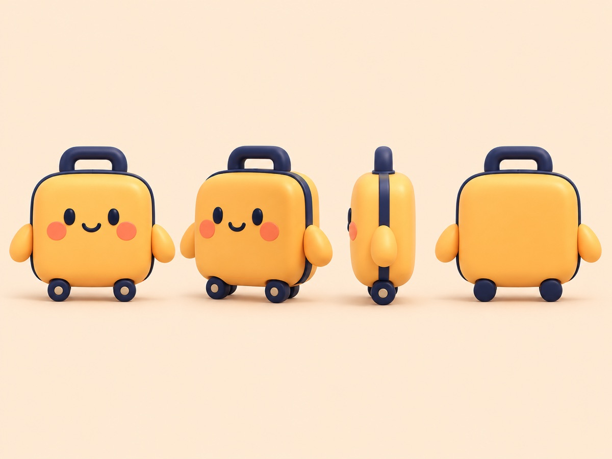
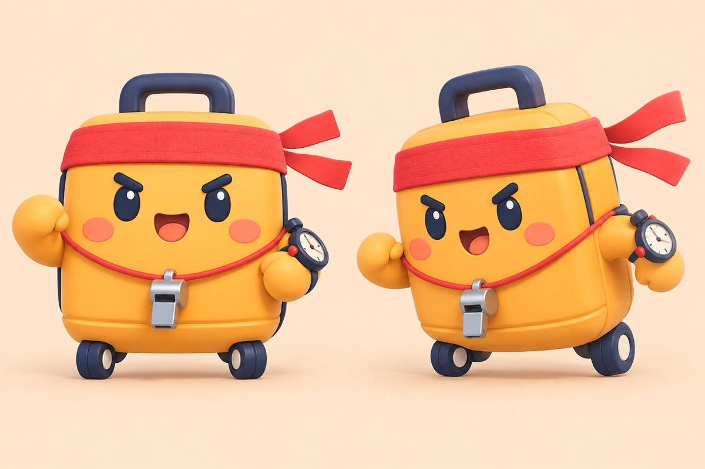
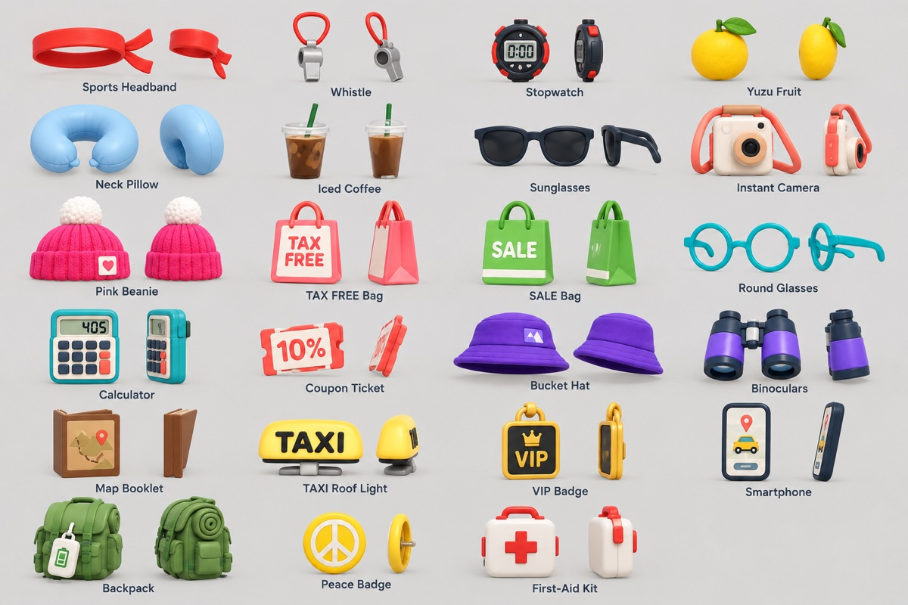
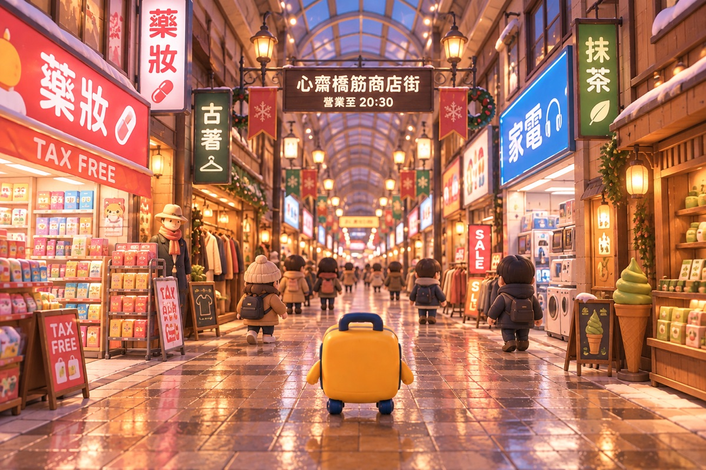
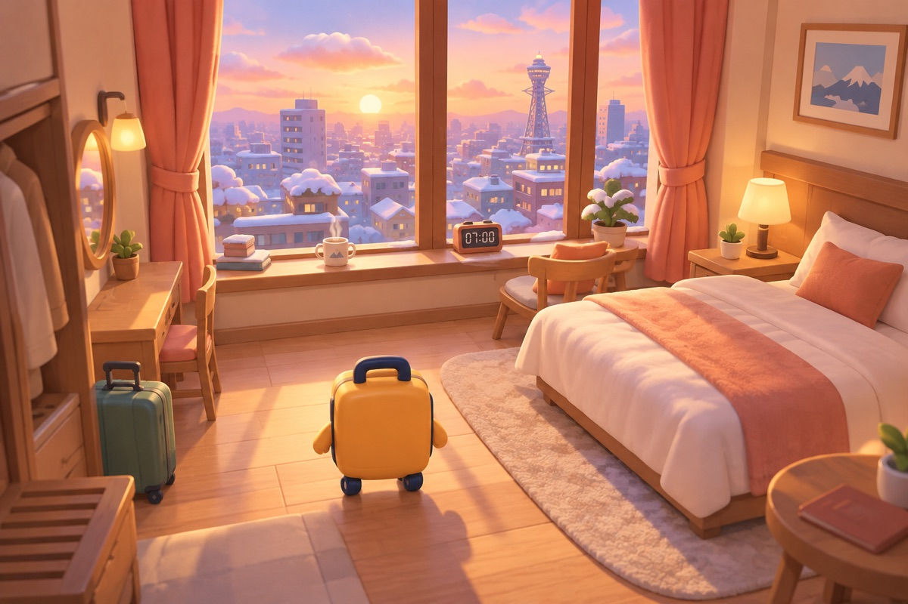
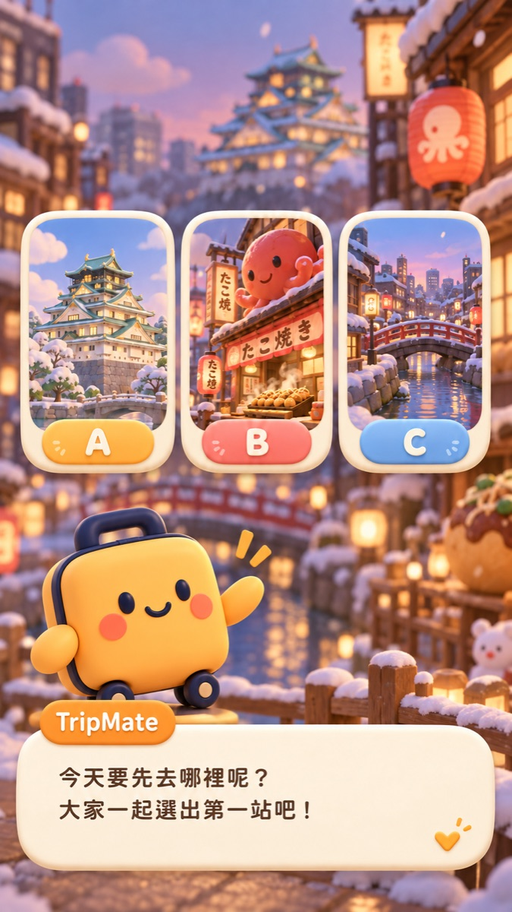

# 去趣 TripMate 3D｜大阪旅程 Unity 版

> 四個人一起去大阪，每到一站就要做一次決定——而手機網路好不好，會直接改變這趟旅程。

**[▶ 線上試玩（WebGL，電腦瀏覽器）](https://shelley56744.github.io/tripmate-unity/)**　｜　[網頁原型 TripMate](https://shelley56744.github.io/tripmatenew/)



| 心齋橋筋商店街：免費 Wi-Fi 出門就離線，導航和小地圖都不能用 | 主選單 |
|---|---|
|  |  |

---

## 專案簡介

TripMate 是 **2026 和泰 AI 黑客松**《金趣咪》團隊的提案作品，題目是「去趣 eSIM 的旅程體驗」。
團隊先做了網頁原型 [TripMate](https://shelley56744.github.io/tripmatenew/)：用排行程 RPG 的方式，讓朋友一起答題、測旅遊人格、排出大家都能接受的行程。

這個 repo 是賽後的延伸版：把網頁原型做成可以走動的 **Unity 3D 大阪街頭**，讓「網路」不再只是結帳頁上的一個選項，而是玩家在旅途中實際感受到的事：

| 選擇的網路 | 在遊戲裡會發生什麼 |
|---|---|
| 免費 Wi-Fi | 出了飯店就離線：沒有導航箭頭和小地圖，拍照上傳、搶整理券都會失敗 |
| 電信漫遊 | 每天 1GB，用完降速：**導航箭頭延遲 3 秒才更新**，有些事會辦不成 |
| 去趣 eSIM | 全程滿格，隨時可以在遊戲裡開通 |

旅程結束時，遊戲會算出「這趟因為網路離線、降速、沒辦成幾件事」，再依實際排好的行程推薦需要的流量方案。

- 場景、角色、音效、特效**全部用程式產生**，沒有匯入任何 3D 模型、貼圖或音檔。
- 題目、8 種旅遊人格、快測、預算、網路方案和隊友設定都沿用網頁原型；第 5～10 站是照同樣格式新寫的。

## 操作方式

線上試玩請用**電腦版瀏覽器**（Chrome、Edge、Safari、Firefox），需要鍵盤和滑鼠；手機目前不支援。第一次載入約需 10～30 秒。

| 按鍵 | 動作 |
|---|---|
| WASD／方向鍵 | 移動 |
| Shift | 跑 |
| 空白鍵 | 跳；對話時是「繼續」 |
| E | 互動（拍照、攤位、泡溫泉⋯） |
| 按住滑鼠拖曳 | 轉鏡頭 |
| 滾輪 | 鏡頭遠近 |
| 1～4／滑鼠點選 | 作答 |
| 滑鼠拖曳（排行程時） | 移動行程格子 |
| H | 顯示／隱藏操作提示 |

## 遊戲流程

1. **主選單**：建立房間（暱稱、目的地、出發日、天數、人數、預算）或輸入代碼加入房間，隊友會陸續進到等待室。
2. **旅遊人格快測**：3 題二選一，對應 8 種人格之一，角色「趣趣」會換上該人格的造型。
3. **10 站旅程**：每站都是可以走動的 3D 場景。自由逛、收集印章、按 E 互動，走到發光的站點後，趣趣出題、隊友各自表態；4 人中有 3 人選一樣（75%）就達成共識，沒達成時趣趣會提出折衷方案。第 1 站結束後選擇要用哪種網路。
4. **結算**：人格比例、團隊默契、最合拍與可以分頭玩的組合、全隊最在意的三件事。
5. **微調行程**：趣趣依 10 站的多數選擇先排好一版，可以拖曳格子調整，看替換建議與交通、預算提醒。
6. **網路方案**：依定版行程估算每天需要多少流量，並列出這趟因為網路卡住的次數。
7. **結局**：依「走完並定版」「6 站以上達成共識」「網路準備好」給 1～3 顆星。

| 站 | 場景 | 時間 | 情境題 |
|---|---|---|---|
| 1 | 飯店前廣場 | 早晨 | 晨間集合 |
| 2 | 樂園 | 上午 | 整理券快沒了 |
| 3 | 道頓堀 | 傍晚 | 晚餐攻防 |
| 4 | 心齋橋筋商店街 | 夜晚 | 打烊前的分流行動 |
| 5 | 大阪城公園 | 早晨 | 天守閣、庭園雪景，還是坐船 |
| 6 | 黑門市場 | 中午 | 邊走邊吃、超市便當，還是老店 |
| 7 | 新世界 | 黃昏 | 登塔、串炸，還是昭和遊樂場 |
| 8 | 梅田 | 傍晚 | 空中庭園、地下街，還是百貨特賣 |
| 9 | 空庭溫泉 | 下午 | 泡湯休息，還是繼續衝 |
| 10 | 飯店前廣場 | 夜晚 | 回程前的最後一晚 |

## 用 Unity 開啟

1. 安裝 **Unity 6000.3.11f1**（Unity 6.3，Built-in Render Pipeline），用 Unity Hub 開啟這個資料夾。
2. 點上方選單 **TripMate → 開啟第一版場景**。
3. 按 **Play ▶**。

輸出網頁版：先在 Unity Hub 加裝「Web Build Support」模組，再點 **TripMate → 輸出 WebGL 網頁版**，檔案會輸出到 `Builds/WebGL/`。也可以用指令列：

```bash
unity build . --target WebGL --execute-method TripMate.EditorTools.TripMateWebGLBuild.BuildCI --output-path Builds/WebGL
```

### 專案結構

```
Assets/TripMate/
├─ Editor/                 選單：建立場景、輸出 WebGL
├─ Resources/
│  ├─ Fonts/               內嵌中文字型（Noto Sans TC 子集）與授權
│  └─ TM_Text3D.shader     立體招牌文字用的 shader
├─ Runtime/                全部遊戲程式（場景、角色、對話、計分、行程、網路）
└─ Scenes/TripMate_Town.unity
media/                     README 用的截圖與概念圖
```

| 想改的東西 | 檔案 |
|---|---|
| 題目、人格、快測、預算、網路、隊友、台詞 | `GameData.cs` |
| eSIM 方案、流量估算、遊戲中的網路狀態 | `Esim.cs` |
| 場景互動點 | `LevelDirector.cs`（位置）、`DialogueUI.Activities.cs`（內容） |
| 計分、共識、默契值、結算 | `GameLogic.cs` |
| 景點、交通估算、預排行程 | `Planner.cs` |
| 各站場景 | `TownBuilder.cs`（飯店、道頓堀）、`AreaBuilder.cs`（其他 7 站） |
| 畫面與流程 | `DialogueUI*.cs`、`LevelDirector.cs` |

## 團隊與 AI 協作

- **團隊**：2026 和泰 AI 黑客松・五人團隊《金趣咪》，隊長 [@Shelley56744](https://github.com/Shelley56744)。黑客松提案與網頁原型 TripMate 是團隊共同的作品。
- **Unity 3D 延伸版**：賽後由隊長延伸開發，沿用網頁原型的題目、人格與網路方案設計。
- **AI 協作方式**：
  - 程式：與 AI 對話協作撰寫 C#。人決定玩法、流程和取捨，在 Unity 裡實際遊玩測試，把錯誤訊息和手感問題回饋給 AI 修改；AI 依需求產生與修改程式。
  - 美術方向：先用 AI 圖像生成畫出角色、道具和場景的概念圖（見下方），再把造型轉成程式產生的 Q 版 3D 形狀。
  - 上架整理：WebGL 輸出設定、中文字型內嵌與這份 README，使用 Claude Code 協助完成。

### 概念參考圖（AI 生成）

這些是開發時用來對齊美術方向的 AI 生成參考圖，**不是遊戲內素材**。

| 趣趣（行李箱角色）四視圖 | 人格造型：行程特種兵 | 旅行道具圖鑑 |
|---|---|---|
|  |  |  |

| 心齋橋商店街 | 飯店早晨 | 答題畫面構想 |
|---|---|---|
|  |  |  |

## 素材與聲明

- 中文字型：[Noto Sans TC](https://github.com/notofonts/noto-cjk)（SIL Open Font License 1.1），只保留遊戲用字與常用字以縮小檔案，授權全文見 `Assets/TripMate/Resources/Fonts/NotoSansTC-OFL-LICENSE.txt`。
- 遊戲中的招牌只使用一般店名文字，不含任何商標。
- 「去趣」與「去趣 eSIM」是黑客松的題目品牌；本專案是參賽提案的延伸作品，不是官方產品。遊戲裡的方案價格、優惠碼與電信商資訊都只是示意。
- 隊友目前由電腦扮演，作答邏輯與網頁原型相同；存檔（印章、配件）只存在自己的瀏覽器或電腦。
